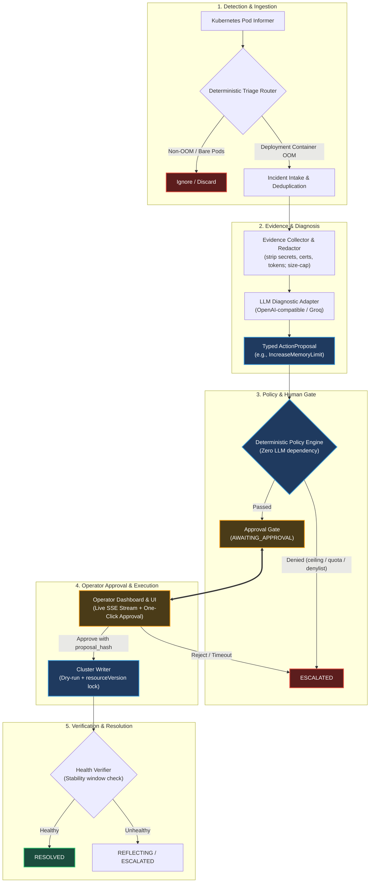
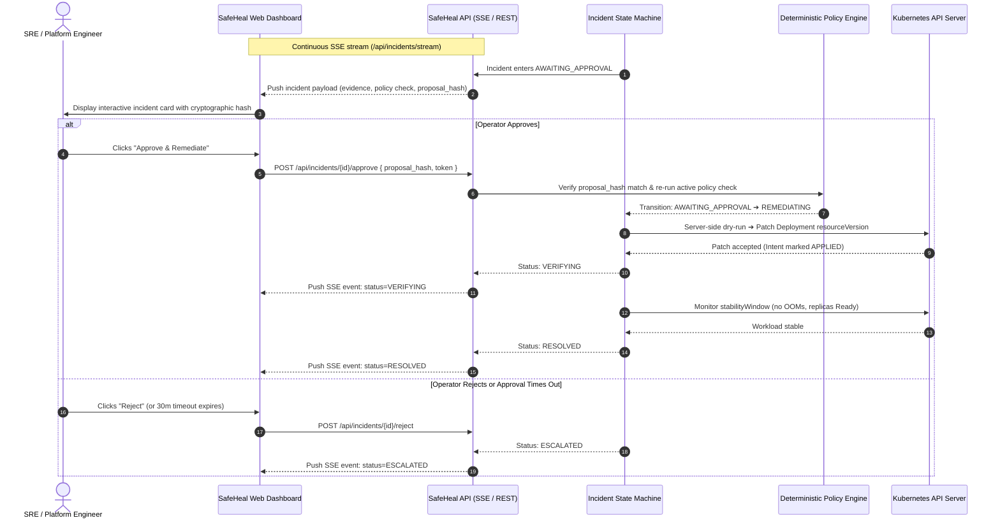
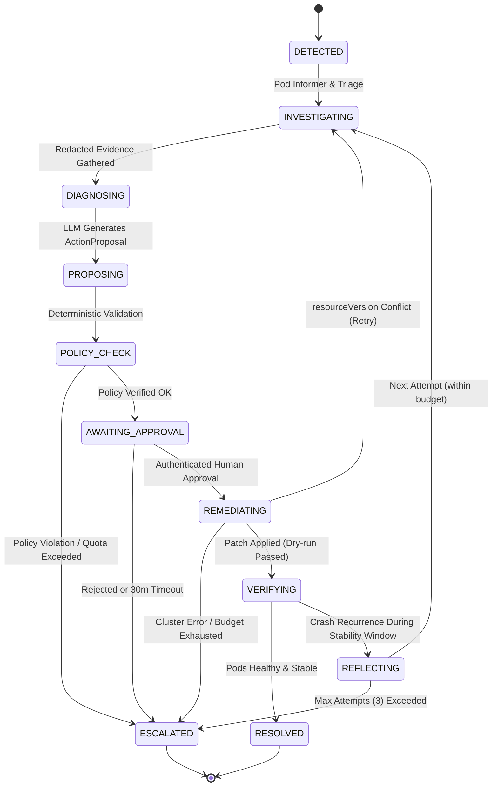

# SafeHeal

> **Deterministic, policy-gated Kubernetes self-healing agent platform.**

SafeHeal detects specific Kubernetes workload failures, collects redacted diagnostic evidence, leverages structured LLM reasoning to propose typed remediations, gates every action through deterministic policy checks and human approvals, applies changes safely to the cluster, and verifies recovery.

---

## Architecture & Safety Guarantees

SafeHeal enforces strict separation between diagnosis, policy evaluation, and cluster execution to eliminate hallucination risk and prevent unauthorized or destructive cluster modifications.



### Safety Invariants

- **Typed Action Proposals**: The LLM only produces a sealed `ActionProposal` (e.g., `IncreaseMemoryLimit`). It never executes arbitrary commands or generates raw shell/kubectl scripts.
- **Deterministic Policy Gating**: The policy engine runs before any cluster modification with zero LLM dependency. It enforces hard ceilings (e.g., maximum memory limits, step ratios), namespace allowlists, system namespace denylists (`kube-system`, `kube-public`, `kube-node-lease`), and cluster-wide hourly caps.
- **Mandatory Human-in-the-Loop Approval**: No cluster write can occur without an authenticated, persisted human approval bound specifically to `(proposal_id, proposal_hash)`.
- **Defense-in-Depth Evidence Redaction**: Workload logs and metadata are treated as untrusted. Logs pass through multi-stage sanitization (redacting bearer tokens, JSON credentials, AWS access keys, and PEM certificates) and strict byte caps before storage or LLM ingress. Prompt-injection lines are preserved verbatim so that the LLM and policy engine remain aware of attack context without execution.
- **ACID-Backed Crash Safety**: State transitions and remediation intents (`pending`, `applied`, `failed`, `abandoned`) are persisted in PostgreSQL 17 before external side effects occur. In the event of an agent crash, work resumes idempotently from the database.
- **Non-Destructive Cluster Writes**: Remediations execute a server-side dry-run first, followed by optimistic locking on Kubernetes `resourceVersion`.
- **Hexagonal Architecture**: Core domain packages (`com.safeheal.incident` and `com.safeheal.agent`) are completely decoupled from framework annotations, Spring, and Fabric8 Kubernetes types, enforced by ArchUnit tests.

---

## Operator Console & Approval UI

SafeHeal provides a real-time web dashboard for SREs and cluster operators. The console visualizes active incidents, streams live status updates over Server-Sent Events (SSE), and provides a cryptographic human approval interface before any cluster change is applied.

### Dashboard Interface Wireframe

```
+────────────────────────────────────────────────────────────────────────────────────────────────────────────+
|  SAFEHEAL CONSOLE                       Cluster: [ kind-safeheal-dev ]           Connection: ● LIVE (SSE)  |
+────────────────────────────────────────────────────────────────────────────────────────────────────────────+
|  ACTIVE INCIDENTS (3)      |  INCIDENT DETAILS: inc-9824f1c9                                               |
|────────────────────────────+───────────────────────────────────────────────────────────────────────────────|
|                            |  Target:      payments / payments-service (Deployment)                        |
|  ● inc-9824f1c9            |  Failure:     Container 'web' OOMKilled (Exit Code 137, Restarts: 3)          |
|    payments-service        |  Lifecycle:   DETECTED ➔ INVESTIGATING ➔ PROPOSING ➔ [AWAITING_APPROVAL]      |
|    [AWAITING_APPROVAL]     |                                                                               |
|                            |───────────────────────────────────────────────────────────────────────────────|
|  ○ inc-7712a84b            |  DIAGNOSTIC EVIDENCE (REDACTED)                                               |
|    order-worker            |  Current Limits:   memory: 256Mi, cpu: 500m                                   |
|    [VERIFYING]             |  OOM Event Time:   2026-10-14T23:38:12Z                                       |
|                            |  Sanitized Logs:   "Allocated 268MB buffer... [REDACTED_AUTH_TOKEN]"          |
|  ○ inc-1093bc21            |───────────────────────────────────────────────────────────────────────────────|
|    auth-api                |  DETERMINISTIC POLICY EVALUATION                                              |
|    [RESOLVED]              |  [✓] Ceiling Rule:       Target 512Mi <= 2Gi absolute max                     |
|                            |  [✓] Step Size Rule:     2x increase <= Max allowable step ratio              |
|                            |  [✓] Namespace Check:    'payments' is in allowlist                           |
|                            |  [✓] Rate Limit Quota:   1 / 5 remediations used this hour                    |
|                            |───────────────────────────────────────────────────────────────────────────────|
|                            |  ACTION PROPOSAL (LLM: Groq / Llama-3.3-70b-versatile)                        |
|                            |  Action Type:        IncreaseMemoryLimit (256Mi ➔ 512Mi)                      |
|                            |  Proposal ID:        prop-4890c2da-3b02-4fc8                                  |
|                            |  Cryptographic Hash: sha256:8f4c2e01b7a9...d901a                              |
|                            |  Rationale:          "Workload OOMs during burst traffic; 512Mi fits quota"   |
|                            |───────────────────────────────────────────────────────────────────────────────|
|                            |  OPERATOR ACTION:                                                             |
|                            |  [ ✔ APPROVE & REMEDIATE ]               [ ✖ REJECT & ESCALATE ]              |
+────────────────────────────────────────────────────────────────────────────────────────────────────────────+
```

### Operator Interaction Flow



---

## Incident Lifecycle (FSM)

Incidents progress through a deterministic Finite State Machine (FSM):



The canonical state machine rules and side effects are defined declaratively as code in `com.safeheal.incident.FsmRules`. Detailed transition tables and side effects can be generated via:

```bash
./gradlew generateFsmDocs
```

*(See [`docs/FSM.md`](docs/FSM.md) for the generated documentation).*

---

## Tech Stack & Toolchain

- **Language**: Java 25 (OpenJDK 25, strict records, sealed interfaces, pattern matching)
- **Framework**: Spring Boot 4.0.x (modular starters: `webmvc`, `actuator`, `jdbc`, `validation`)
- **Build Tool**: Gradle 9.8+ (Kotlin DSL: `build.gradle.kts`, `settings.gradle.kts`)
- **Kubernetes Client**: Fabric8 Kubernetes Client 8.0+
- **Persistence**: PostgreSQL 17, Flyway Database Migrations, Spring `JdbcClient`
- **Testing**:
  - JUnit 5 & AssertJ
  - ArchUnit 1.4.x (hexagonal architecture boundaries)
  - Testcontainers 2.x (PostgreSQL 17 container & K3s real-cluster container)
  - WireMock (external LLM mock)
  - Fabric8 Kubernetes Server Mock

---

## Repository Structure

```
├── build.gradle.kts            # Gradle build configuration (Java 25, Spring Boot 4)
├── docker-compose.yml          # PostgreSQL 17 local database with role separation
├── kind-config.yaml            # KinD cluster configuration (safeheal-dev)
├── docs/                       # Project documentation & architectural decisions
│   ├── BRIEF.md                # System brief, goals, safety defaults, non-goals
│   ├── ARCHITECTURE.md         # Hexagonal layout, trust boundaries, SPIs
│   ├── DECISIONS.md            # Architectural Decision Records (ADRs)
│   └── FSM.md                  # Generated incident state machine specification
├── infra/
│   └── postgres/init-roles.sql # PostgreSQL role setup (safeheal_owner vs safeheal_app)
└── src/
    ├── main/
    │   ├── java/com/safeheal/
    │   │   ├── Application.java
    │   │   ├── agent/          # Detection, evidence gathering, redaction, triage
    │   │   ├── api/            # REST API endpoints, SSE live stream, approval controllers
    │   │   ├── approval/       # Cryptographic human approval binding
    │   │   ├── audit/          # Immutable audit trail recording
    │   │   ├── config/         # Properties, context guards (Rule 16)
    │   │   ├── incident/       # Pure domain FSM, transitions, entities
    │   │   ├── k8s/            # Fabric8 cluster reader, informer sources, context guards
    │   │   ├── llm/            # LLM client adapters and prompt construction
    │   │   ├── persistence/    # JdbcClient repositories & Flyway migrations
    │   │   └── policy/         # Deterministic policy rules & ApprovedAction factory
    │   └── resources/
    │       ├── application.yml
    │       └── db/migration/   # Flyway SQL migrations (V1, V2, ...)
    └── test/                   # Unit, architectural, table-driven, and E2E integration tests
```

---

## Getting Started

### Prerequisites

- **Java JDK 25** (e.g. Eclipse Temurin 25)
- **Docker** (daemon running for local database and Testcontainers)
- **KinD** (`kind`) or **K3s** for local Kubernetes development
- **kubectl**

### Local Setup

#### 1. Start PostgreSQL

Run PostgreSQL 17 with the provisioned role separation (`safeheal_owner` and `safeheal_app`):

```bash
docker compose up -d
```

#### 2. Provision Local Kubernetes Cluster

Create a local KinD cluster configured for SafeHeal development:

```bash
kind create cluster --config kind-config.yaml
```

Verify your active context is allowlisted (default: `kind-safeheal-dev`):

```bash
kubectl config current-context
```

#### 3. Run Build & Tests

Execute the full suite of unit, architecture, and containerized integration tests:

```bash
./gradlew test
```

To regenerate the FSM documentation directly from the domain rule definitions:

```bash
./gradlew generateFsmDocs
```

#### 4. Run the Application

Start the SafeHeal service locally:

```bash
./gradlew bootRun
```

Actuator health endpoints are accessible at:
- `http://localhost:8080/actuator/health`

---

## Configuration Properties

SafeHeal properties are configured under the `safeheal` prefix in `src/main/resources/application.yml`:

| Property | Default | Description |
|---|---|---|
| `safeheal.mode` | `KUBECONFIG` | Runtime cluster mode (`KUBECONFIG` or `IN_CLUSTER`). |
| `safeheal.kubeconfig-context` | `kind-safeheal-dev` | Target Kubernetes context to bind to in `KUBECONFIG` mode. |
| `safeheal.allowed-contexts` | `["kind-safeheal-dev"]` | Safety allowlist of permitted kubeconfig contexts (refuses startup if unmatched). |
| `safeheal.allowlisted-namespaces` | `["default"]` | List of Kubernetes namespaces monitored for failure detection. |

---

## Testing Strategy

SafeHeal adheres to rigorous testing standards:

- **Hexagonal Architecture Tests**: ArchUnit validates that no Spring Framework or Fabric8 Kubernetes Client classes are imported inside domain packages (`com.safeheal.incident` and `com.safeheal.agent`).
- **Deterministic Table Tests**: Evaluates OOM detection, triage routing, and state machine transition rules against comprehensive positive and negative test matrices.
- **Adversarial & Injection Tests**: Validates evidence collection, multi-pass redaction against AWS keys, bearer tokens, PEM certificates, and ensures prompt-injection attempts inside pod logs do not escape the redactor.
- **E2E Cluster Integration Tests**: Real Kubernetes crash scenarios executed against live K3s containers via Testcontainers (`K3sOomDetectionE2EIT`), verifying pod informers, triage routing, deduplication, and cooldowns.

---

## Project Documentation

For in-depth architectural specifications and operational decisions:

- [`docs/BRIEF.md`](docs/BRIEF.md): Core platform requirements, scope, and safety defaults.
- [`docs/ARCHITECTURE.md`](docs/ARCHITECTURE.md): Component breakdown, trust boundaries, and SPI design.
- [`docs/DECISIONS.md`](docs/DECISIONS.md): Architectural Decision Records (ADRs).
- [`docs/FSM.md`](docs/FSM.md): Declarative state machine transition rules and side effects.
